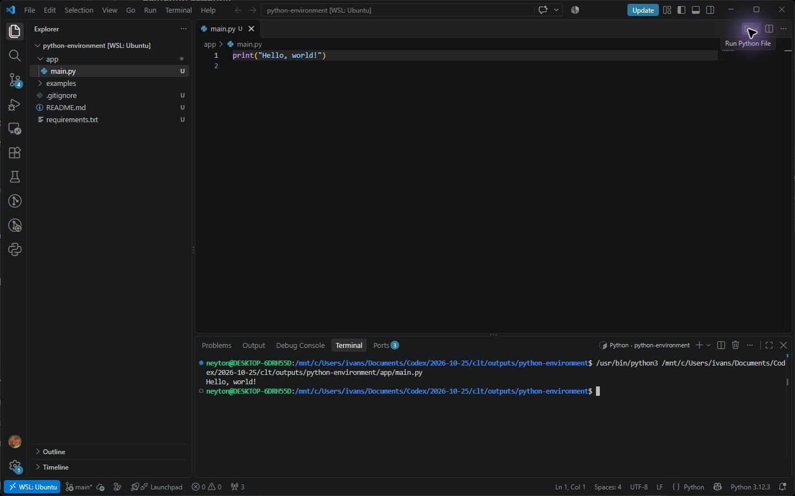

# Настройка среды разработки Python

Учебный проект для знакомства с Python, VS Code, WSL и Git. Программа выводит приветствие в терминале.

## Структура проекта

```text
.
├── app/
│   └── main.py
├── examples/
│   └── vscode-run.png
├── .gitignore
├── README.md
└── requirements.txt
```

- `app/main.py` — основная программа.
- `examples/vscode-run.png` — скриншот VS Code с результатом запуска.
- `.gitignore` — файлы, которые Git не должен отслеживать.
- `requirements.txt` — список зависимостей. Сейчас файл пустой: программе достаточно стандартного Python.

## Запуск

Откройте терминал в корневой папке проекта и выполните:

```bash
python3 app/main.py
```

Результат:

```text
Hello, world!
```

## Пример работы


