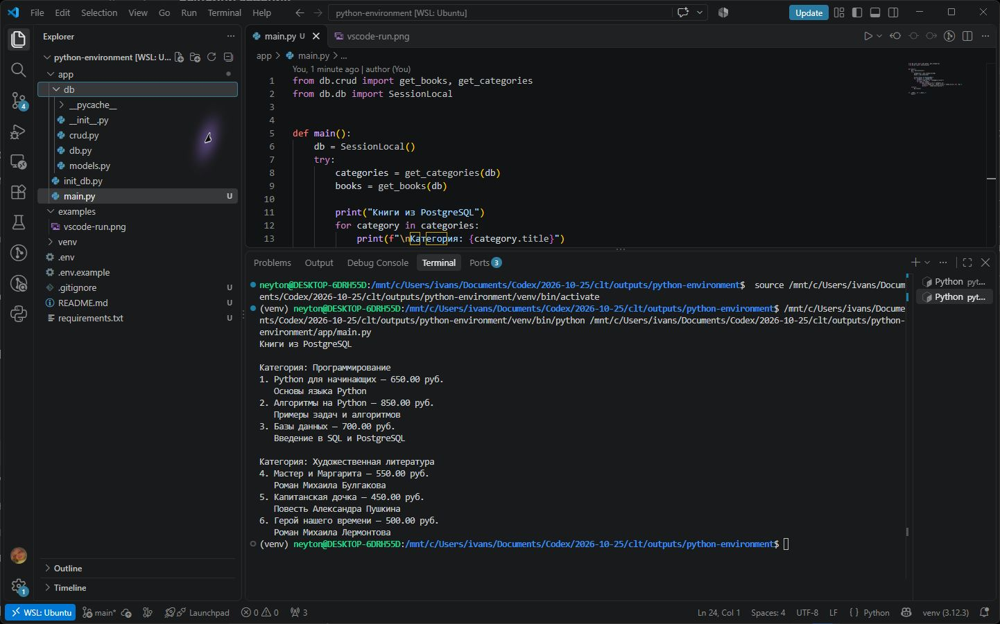

# Книги и категории в PostgreSQL

Учебный проект на Python и SQLAlchemy. В базе хранятся категории и книги. Для обеих таблиц есть функции добавления, чтения, изменения и удаления.

## Структура

```text
app/
├── db/
│   ├── __init__.py
│   ├── db.py
│   ├── models.py
│   └── crud.py
├── init_db.py
└── main.py
examples/
├── vscode-run.png
└── postgresql-run.png
.env.example
.gitignore
requirements.txt
```

`db.py` подключается к PostgreSQL. В `models.py` описаны таблицы `categories` и `books`. Функции CRUD находятся в `crud.py`.

## Подготовка PostgreSQL в Ubuntu WSL

```bash
sudo apt install postgresql python3-venv
sudo service postgresql start
sudo -u postgres psql
```

В консоли PostgreSQL выполните:

```sql
CREATE USER octagon WITH PASSWORD '12345';
CREATE DATABASE octagon_db OWNER octagon;
\q
```

## Установка зависимостей

В терминале WSL из корневой папки проекта:

```bash
python3 -m venv venv
source venv/bin/activate
pip install -r requirements.txt
cp .env.example .env
```

Параметры подключения находятся в `.env`. В примере указаны база `octagon_db`, пользователь `octagon`, адрес `localhost` и порт `5432`. Файл `.env` и папка `venv` исключены из Git.

## Запуск

```bash
python app/init_db.py
python app/main.py
```

Первый скрипт создаёт таблицы и добавляет две категории с тремя книгами в каждой. Если категории уже есть, повторный запуск не добавляет данные. Второй скрипт читает базу и выводит названия, цены и описания книг.

## Результат


