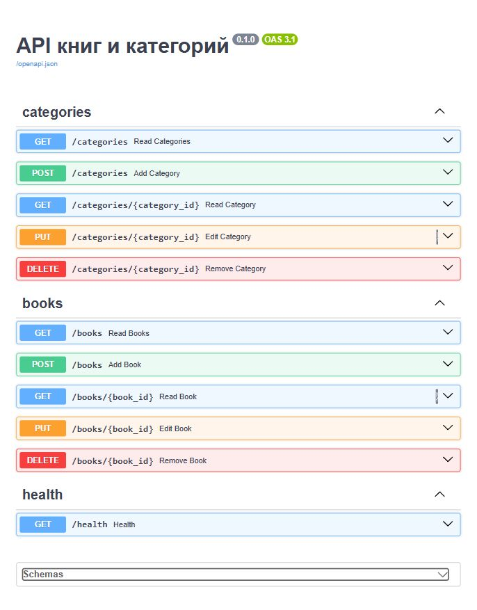
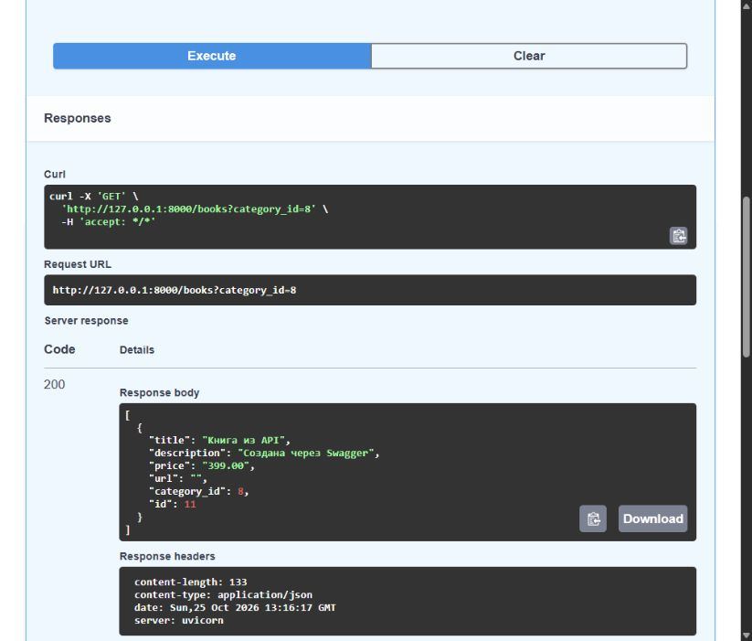
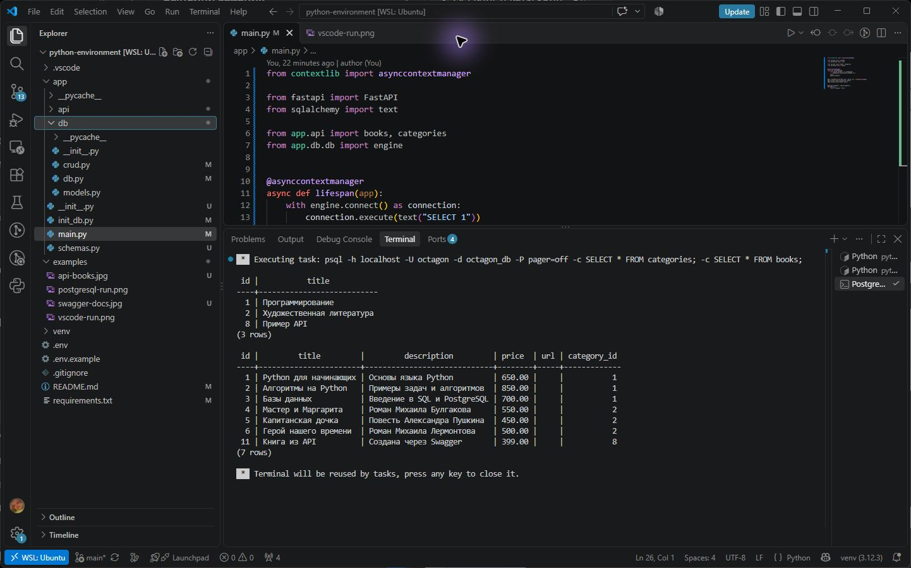

# API книг и категорий

Простой API на FastAPI для работы с книгами и категориями. Данные хранятся в PostgreSQL, запросы к базе выполняются через SQLAlchemy.

## Структура

```text
app/
├── __init__.py
├── api/
│   ├── __init__.py
│   ├── books.py
│   └── categories.py
├── db/
│   ├── __init__.py
│   ├── db.py
│   ├── models.py
│   └── crud.py
├── init_db.py
├── main.py
└── schemas.py
examples/
├── swagger-docs.jpg
├── api-books.jpg
└── psql-api.png
.env.example
.gitignore
requirements.txt
```

`db.py` содержит подключение и зависимость `get_db`. В `models.py` описаны таблицы, в `crud.py` находятся операции с БД. В папке `api` расположены роутеры, а в `schemas.py` — Pydantic-схемы запросов и ответов.

## Подготовка PostgreSQL в Ubuntu WSL

```bash
sudo apt install postgresql python3-venv
sudo service postgresql start
sudo -u postgres psql
```

В консоли PostgreSQL выполните:

```sql
CREATE USER octagon WITH PASSWORD '12345';
CREATE DATABASE octagon_db OWNER octagon;
\q
```

## Установка зависимостей

В терминале WSL из корневой папки проекта:

```bash
python3 -m venv venv
source venv/bin/activate
pip install -r requirements.txt
cp .env.example .env
```

Параметры подключения находятся в `.env`. В примере указаны база `octagon_db`, пользователь `octagon`, адрес `localhost` и порт `5432`. Файл `.env` и папка `venv` исключены из Git.

## Запуск

```bash
python -m app.init_db
uvicorn app.main:app --reload
```

Инициализация создаёт две категории с тремя книгами в каждой. Если категории уже есть, данные повторно не добавляются. При запуске API проверяется подключение к PostgreSQL.

После запуска откройте:

- http://127.0.0.1:8000/health — проверка работы сервиса;
- http://127.0.0.1:8000/docs — Swagger, где можно отправлять запросы.

## Эндпоинты

| Метод | Путь | Действие |
| --- | --- | --- |
| GET | `/categories` | Все категории |
| GET | `/categories/{category_id}` | Одна категория |
| POST | `/categories` | Создать категорию |
| PUT | `/categories/{category_id}` | Изменить категорию |
| DELETE | `/categories/{category_id}` | Удалить категорию и её книги |
| GET | `/books` | Все книги |
| GET | `/books?category_id=1` | Книги выбранной категории |
| GET | `/books/{book_id}` | Одна книга |
| POST | `/books` | Создать книгу |
| PUT | `/books/{book_id}` | Изменить книгу |
| DELETE | `/books/{book_id}` | Удалить книгу |

Создание возвращает код `201`, удаление — `204`. Если книга или категория не найдена, возвращается `404`. Повторное название категории даёт `409`, неверные данные — `422`. Для `PUT` передаются все поля книги. При создании и изменении книги проверяется её категория.

В Pydantic используется `from_attributes=True` для чтения объектов SQLAlchemy. Цена хранится в PostgreSQL как `Numeric`, а в JSON возвращается строкой, например `"650.00"`.

Пример запроса:

```bash
curl -i 'http://127.0.0.1:8000/books?category_id=1'
```

## Результат






